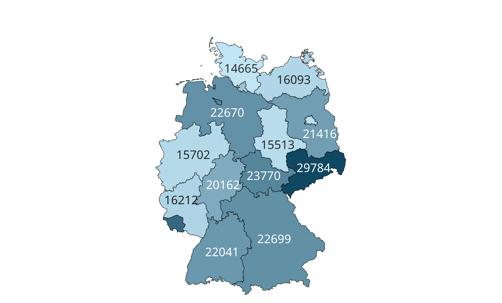

In recent years German universities in all federal states have seen steep budget cuts. As a student myself, I was curious about how this manifests. My own university has the reputation of being chronically underfunded. How underfunded are German universities really? How are budget cuts politically justified and how do they look like?

University funding in Germany is the responsibility of the states, not of the federal government. Furthermore, unlike the federal government, states are not allowed to take up credit, as it is forbidden by the "Debt Break", a constitutional law in Germany that aims at reducing the amount of debt government has. This, when coupled with very tight budgets, leads to states having to reduce investments into the future: Building bridges, maintaining roads, expanding public transportation - and of course education, which has the potential to [add billions to the economy](https://www.bertelsmann-stiftung.de/de/unsere-projekte/change-learning/projektnachrichten/rund-21-billionen-euro-zusaetzliche-wirtschaftsleistung-durch-bessere-bildung). 

## Budget Cuts

Some universities have seen cuts as steep as 10% year over year for their annual budgets. As a result, student coordinators are losing their jobs, young academics do not find jobs, important work is not being done. 

Instead, we are seeing a trend towards funding universities through the use of funds. These funds have a limited runtime and can be dissolved without political cost when money is tight. They make budgeting in the education ministries much easier,  but stop ANY form of planning security on the level of the university. 

It also leads to non-sensical expenses. If the fund you have successfully applied to has excess cash which you do not need for your project, you are in no way disincentivised from using this money. Rather, you want to spend this money because otherwise it will not be accessible to you or your institution. The result is excess money for decorative benches, office decor and student jobs in writing newsletters noone is reading. On the other hand, student jobs that previously came from the more flexible university budget can no longer be financed and important work is not being done anymore. 

## EXPAND ON THIS, NAME CONCRETE EXAMPLES, TRY TO GET DATA FOR THE FUNDS THING

## How underfunded are universities really?

For this, I have tried to unsuccessfully find a comprehensive list of the funding of all universities in Germany. I did notice that the "Federal Statistical Office of Germany", or DESTATIS, did have comprehensive data on the funding of academic subfields. They also had datasets on the amount of students enrolled at individual universities. This led me to believe that internally, they probably do have the funding of individual universities in a dataset. The question is, of course, if I can get that somehow. 

It turns out, I do: One e-mail to the DESTATIS office later, and I had a full table on the budgets of individual universities for the year 2024. Combining this with the already publicly available data on the DESTATIS website, we can not only find out which universities spend the most, but also how much they spend per student, a much more useful measurement.

### Results

Of course, what is most interesting to me is the bottom of the pile: The freshly founded *[University of Koblenz](https://en.wikipedia.org/wiki/University_of_Koblenz)* is the worst funded traditional public university. Only the "*[Fernuniversität Hagen](https://en.wikipedia.org/wiki/University_of_Hagen)*", a university for remote studying, is funded worse. The *[Europa-Universität Flensburg](https://en.wikipedia.org/wiki/University_of_Flensburg)*, which itself only exists since 1994, ranks third last. 

Try **searching** for *OU* in the table below and **sort** by *ausgabenprostudi_r*!

---



*"ausgaben": expenses in 1000 euros, "ausgabenprostudi_r": expenses per student in euros*

The data and explanations are available [here.](/projects/university-funding/data.html)

---

The data can also tell us which universities are best funded. On spot number one is the *Technical University of Munich* ([TUM](https://en.wikipedia.org/wiki/Technical_University_of_Munich)). No surprises here. What did surprise me is finding a "university" I have never heard of: The *[University of Veterinary Medicine Hannover](https://en.wikipedia.org/wiki/University_of_Veterinary_Medicine_Hannover)*. It is included under universities because it offers PhD programs. It has such a high ratio because it works similarly to a university hospital (which are not included in the dataset). Multiple working vetenary clinics increase expenses in a way that is not the case for normal universities. 

What is surprising are regional differences: Taking the average of Universities with over 1000 students, universities in Saxony spend by far the most per student, at over 29 thousand euros. In comparison, in Schleswig-Holstein, the state where universities spend the least, it is less than half, at 14600 euros. 

The rich southern states Bavaria and Baden-Württemberg rank fifth and seventh, respectively. 

 *Missing: Berlin: 15086, Bremen: 23752, Saarland: 26689*